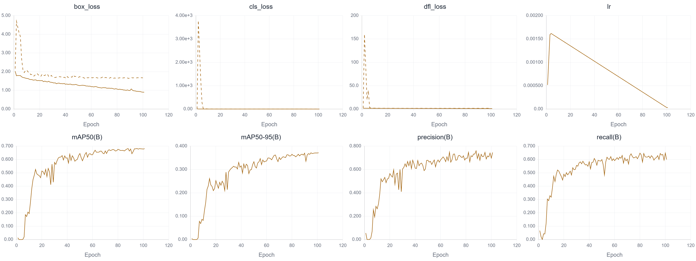

\# 🔥 Fire \& Smoke Detection based on YOLO11s


这是一个基于 YOLO11s 的明火与烟雾目标检测项目。

本项目使用 5000 张多场景图像进行训练，模型在验证集上取得了 \*\*mAP50: 68.1%\*\* 的精度。


\## 📊 模型性能 (Validation Set)

\* \*\*mAP50\*\*: 68.1%

\* \*\*mAP50-95\*\*: 37.1%

\* \*\*Precision\*\*: 74.5%

\* \*\*Recall\*\*: 60.0%


## 📈 训练过程曲线 (Training Curves)

下图为模型 100 轮训练过程中的各项损失函数、学习率以及精度指标变化图：

<div align="center">
  
</div>


\## 🚀 快速开始 (Quick Start)

1\. 克隆仓库并安装依赖：

&#x20;  `pip install -r requirements.txt`

2\. 使用提供的模型进行推理测试：

&#x20;  `python predict.py --source assets/demo\_before.jpg`


\## 🛠️ 训练过程 (Training)

本项目由 RTX 3090 训练完成。

训练参数配置见 `train.py` 与 `data.yaml`。


\## 📂 项目结构

```text

├── weights/

│   └── firesmokeyolo11s.pt           # 预训练模型权重 (直接下载即可使用)

├── assets/               # 存放 README 中的展示图片

├── predict.py            # 推理/预测脚本 (支持图片、视频、摄像头)

├── train.py              # 模型训练脚本 (配置参数)

├── data.yaml             # 数据集配置文件

├── requirements.txt      # 环境依赖

└── README.md             # 项目说明文档

